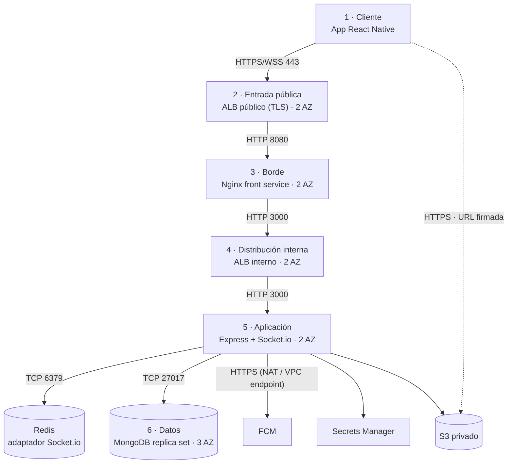

# 01 · Vista general

> Fuente: *Informe de arquitectura técnica* (7/10/2026) + correcciones de revisión (ver [ADRs](adr/README.md) y [pendientes](../pendientes.md)).
> Este documento es la referencia de nombres: **si otro doc usa otro nombre para una capa, está mal**.

## Qué es junte

App móvil de planes universitarios: crear planes, ver actividades cercanas recomendadas, inscribirse, registrar asistencia (QR + ubicación), chatear por plan, recibir notificaciones y reportar contenido. Incluye un panel web `/admin` para moderación.

## Las seis capas (nombres fijos)

| # | Capa | Componente | Dónde vive | Responsabilidad única |
|---|------|-----------|------------|-----------------------|
| 1 | **Cliente** | App React Native (Expo) | Teléfono, fuera de AWS | UI, permisos del dispositivo, offline. Solo habla con la API. |
| 2 | **Entrada pública** | ALB público | Subredes públicas, 2 AZ | Termina TLS (ACM), único punto con presencia pública, health check a Nginx. En el informe se la llama "DMZ": es la misma capa. |
| 3 | **Borde** | Front service (Nginx) | EC2 privadas, 2 AZ | Publica `/api/v1`, IP real, rate limiting, límite de tamaño, `requestId`, proxy REST/WebSocket, estáticos de `/admin`. **Sin lógica de negocio.** |
| 4 | **Distribución interna** | ALB interno | Subredes privadas, 2 AZ | Balancea entre back services. Health check a `/internal/health`. |
| 5 | **Aplicación** | Back service (Node.js + Express + Socket.io) + Redis | EC2 privadas, 2 AZ | Auth/JWT, reglas de negocio, transacciones, Socket.io (coordinado por Redis), S3, FCM, Secrets Manager. **Único que toca MongoDB.** |
| 6 | **Datos** | MongoDB replica set | 3 nodos, 3 AZ, subred de datos | Persistencia. Replica set obligatorio (transacciones). |

## Diagrama lógico



## Flujo de una request (ejemplo: inscribirse)

```
App ──POST /api/v1/plans/:id/join──▶ ALB público (TLS)
    ──▶ Nginx: IP real, rate limit, X-Request-Id, reescribe a /internal/plans/:id/join
    ──▶ ALB interno ──▶ Express
        requestId → auth JWT → validate(Zod) → controller → service → repository → MongoDB (transacción)
    ◀── 201 { ... }  (o error { code, message, requestId })
```

Dentro del back service el orden es siempre el mismo: **ruta → middlewares → controlador → servicio → repositorio/modelo → MongoDB**. Detalle en [03-back-service.md](03-back-service.md).

## Repositorio

```
junte/
  mobile/           # Capa 1 — ver 05-mobile.md
  front-service/    # Capa 3 — ver 04-front-service.md
  back-service/     # Capa 5 — ver 03-back-service.md
  infra/            # docker-compose de desarrollo, scripts de AWS
  docs/
  Taskfile.yml
  CLAUDE.md
  README.md
```

## Principios de arquitectura que guían todo

1. **Cada capa tiene una sola responsabilidad.** Si Nginx empieza a validar reglas de negocio o la app decide permisos, está mal.
2. **Identidad desde el token, nunca desde el body.**
3. **Back service sin estado local** (sesiones, timers, caché en memoria que importe): hay 2+ instancias detrás del ALB interno. Lo compartido va a MongoDB o Redis.
4. **Nada público salvo el ALB público.** Ninguna EC2 tiene IP pública ni puerto 22 abierto.
5. **Consistencia por transacción**, nunca "consultar y después escribir" para cupos o contadores.
6. **Cambios de esquema e índices solo por migraciones** ([migraciones.md](../practicas/migraciones.md)).

## Fuera de alcance

Lambda, API Gateway administrado, DynamoDB, Kubernetes, Cognito (posible evolución, no ahora).
