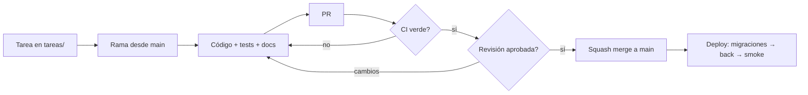

# Flujo de trabajo

De una tarea del backlog a producción.



## 1. Tomar una tarea

- Las tareas están en [`docs/tareas/`](../tareas/README.md) con un ID (`S3-BE-04`).
- Antes de arrancar: leer los criterios de aceptación y las [decisiones pendientes](../pendientes.md) que la afecten. **Si algo no está definido, se pregunta antes de inventarlo.**
- Marcarla como "en curso" con tu nombre en el tablero.

## 2. Rama

Desde `main` actualizado:

```
feat/S3-BE-04-plans-near-query
fix/S4-BE-02-join-double-count
docs/adr-0008-sessions
chore/eslint-boundaries
```

Formato: `<tipo>/<id-tarea>-<descripcion-corta>`. Ramas cortas: idealmente se mergean en 1–2 días. `main` siempre debe estar desplegable.

## 3. Desarrollar

Orden recomendado para una funcionalidad del back:

1. **Contrato**: confirmar el endpoint en [06-api.md](../arquitectura/06-api.md) (y actualizarlo si cambia).
2. **Migración** si hay índices o campos nuevos.
3. **Validators** (Zod) + **tests de servicio** con los casos de la tarea → fallan.
4. **Servicio** hasta que pasen.
5. **Repositorio** + test de integración si hay queries nuevas o transacciones.
6. **Controller + routes + serializer** + test de contrato.
7. App: service → hook (+ test) → screen.

`task ci` localmente antes de abrir el PR.

## 4. Commits

[Conventional Commits](https://www.conventionalcommits.org/), en inglés, en imperativo:

```
feat(plans): add $geoNear query with radiusKm
fix(participations): roll back counter when duplicate join
test(checkins): cover expired QR and out-of-range cases
docs(api): add POST /devices
refactor(feed): extract scorers into pure functions
chore(deps): bump mongoose
```

Tipos: `feat`, `fix`, `test`, `docs`, `refactor`, `chore`, `ci`, `perf`. Scope = módulo.

## 5. Pull request

Título = commit principal. Descripción con esta plantilla (`.github/pull_request_template.md`):

```markdown
## Qué
Tarea: S3-BE-04. Resumen en 1–3 líneas.

## Cómo probarlo
Pasos o comandos.

## Checklist
- [ ] Tests nuevos/actualizados y `task ci` en verde
- [ ] Migración con up/down (si aplica)
- [ ] docs/ actualizado (API, modelo, ADR) si cambió el contrato o una decisión
- [ ] Sin secretos, tokens ni coordenadas en código o logs
- [ ] Capturas (si cambia UI)
```

PRs chicos (idealmente < 400 líneas cambiadas). Si es más grande, se parte.

## 6. CI (GitHub Actions)

En cada PR y push a `main`:

1. `npm ci` en back y app.
2. Lint.
3. Tests del back (unitarios, integración, contrato) con Mongo en memoria.
4. Migraciones `up → down → up`.
5. Tests de la app.
6. `nginx -t` del front service.
7. `cfn-lint` de los templates de CloudFormation (`infra/templates/`). No despliega ni usa credenciales de AWS.

Si CI está en rojo, no se revisa ni se mergea.

## 7. Revisión

- Al menos **una aprobación** de otra persona del equipo.
- El revisor usa el checklist de [definicion-de-hecho.md](definicion-de-hecho.md#checklist-de-revisión).
- Comentarios con prefijo: `bloqueante:`, `sugerencia:`, `pregunta:`, `nit:`. Solo `bloqueante:` impide aprobar.
- Se revisa el diseño y el comportamiento; el formato lo resuelve el linter.

## 8. Merge

**Squash merge** a `main` (un commit por PR, historial limpio). Se borra la rama.

## 9. Deploy

Ver [10-despliegue.md](../arquitectura/10-despliegue.md#despliegue-de-una-versión-del-back-service): migraciones → instancias de a una → smoke test. La app se publica como APK con EAS desde un tag (`v0.4.0`).

## Ceremonias (sprints de 1 semana)

| Cuándo | Qué | Salida |
|--------|-----|--------|
| Inicio | Planificación: elegir tareas del sprint, resolver pendientes bloqueantes | Tareas asignadas |
| Diario (asincrónico) | Qué hice / qué hago / qué me bloquea | Bloqueos visibles |
| Fin | Demo del incremento en un teléfono + revisión del backlog | Tareas del próximo sprint ajustadas, ADRs nuevos si hubo decisiones |
