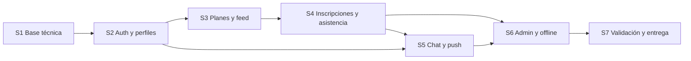

# Backlog y tablero

Siete sprints de una semana, tal como el informe (sección 8). Cada sprint tiene su archivo con objetivo, entregable, decisiones que lo bloquean y tareas con criterios de aceptación.

## Cómo usar

- **ID de tarea:** `S<sprint>-<área>-<nn>`. Áreas: `INF` infraestructura AWS/local · `BE` back service · `NG` front service Nginx · `MOB` app · `QA` pruebas transversales · `DOC` documentación.
- El ID va en la rama (`feat/S2-BE-03-...`), en el PR y en los `TODO` del código.
- Estado en este tablero: `⬜ pendiente` · `🔄 en curso (nombre)` · `✅ hecha` · `⛔ bloqueada (motivo)`.
- Una tarea está hecha cuando cumple la [definición de hecho](../flujo/definicion-de-hecho.md), no cuando "anda".
- Si al implementar aparece algo no definido → se agrega a [pendientes](../pendientes.md) y se pregunta.

## Sprints

| Sprint | Archivo | Entregable | Estado |
|--------|---------|-----------|--------|
| 1 | [01-base-tecnica.md](01-base-tecnica.md) | Estructura, entorno local, modelos + migraciones, topología AWS, `/health` por HTTPS | 🔄 (local ✅, AWS ⬜ a cargo del equipo de AWS) |
| 2 | [02-auth-y-perfiles.md](02-auth-y-perfiles.md) | Registro, login, refresh, perfil y foto desde el teléfono | ✅ + 2b catálogos y onboarding (app sin probar en emulador/teléfono; el bucket S3 lo crea el equipo de AWS) |
| 3 | [03-planes-y-feed.md](03-planes-y-feed.md) | CRUD de planes y feed geográfico recomendado, con filtros, costo y cupo ilimitado | ✅ (app probada en teléfono con Expo Go; falta la clave de Google Maps, los permisos de S3 sobre `plans/*` y subir la foto del plan desde la app) |
| 4 | [04-inscripciones-asistencia.md](04-inscripciones-asistencia.md) | Inscripción transaccional, QR, check-in, reputación, `noShow` | ⬜ |
| 5 | [05-chat-y-notificaciones.md](05-chat-y-notificaciones.md) | Chat por plan con Socket.io + fallback, push FCM | ⬜ |
| 6 | [06-admin-y-movil.md](06-admin-y-movil.md) | Panel `/admin`, offline, observabilidad, backups | ⬜ |
| 7 | [07-validacion-y-entrega.md](07-validacion-y-entrega.md) | E2E, seguridad, concurrencia, restauración, APK | ⬜ |

## Dependencias entre funcionalidades

El chat (S5) depende de las inscripciones (S4) porque el permiso es "participante activo o creador". El panel admin (S6) depende de `role` (S1–S2) y de reportes/mensajes.

## Decisiones bloqueantes por sprint

| Sprint | Decidir antes de empezar |
|--------|--------------------------|
| 1 | Redis (ElastiCache vs EC2) |
| 2 | ✅ Sesiones múltiples, perfil completo, fecha de nacimiento (decididos) |
| 3 | ✅ Intereses del plan, compatibilidad horaria, paginación del feed, visibilidad, filtros, costo y cupo ilimitado (decididos) |
| 4 | ✅ Parámetros del check-in, estados del plan, reactivación y jobs: decididos en [s4-decisiones.md](s4-decisiones.md). El aviso de cupo liberado pasó completo a S5 |
| 5 | Notas de voz y contactos (cupo liberado: ✅ decidido) |
| 6 | Endpoints y métricas de admin |
